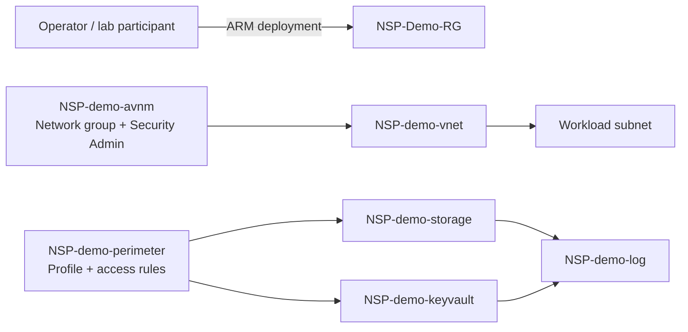

# Architecture

## Control-plane responsibilities

**NSP** is the PaaS resource boundary. The associations put Storage and Key Vault in an enforced perimeter profile. The lab first captures baseline behavior and then tests access after enforcement.

**AVNM** is the VNet governance layer. Its security-admin configuration applies centrally to the demo VNet and denies inbound RDP. This is independent of NSP and demonstrates defense in depth.

**Identity and data controls remain necessary.** NSP does not replace Entra ID/RBAC, Key Vault authorization, encryption, TLS, application authorization, or monitoring. The demo deliberately keeps those controls visible rather than presenting NSP as a complete security solution.

## Expected learning outcome

Participants should be able to explain the difference between:

1. Resource-level PaaS network exposure control (NSP).
2. VNet traffic governance (AVNM).
3. Workload identity and authorization (RBAC).
4. Observability and operational response (Log Analytics and activity logs).
